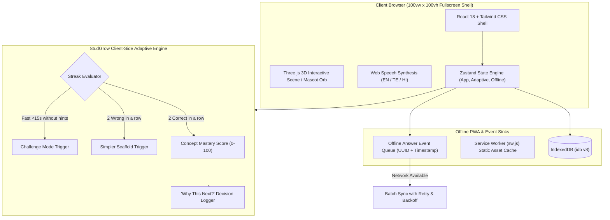
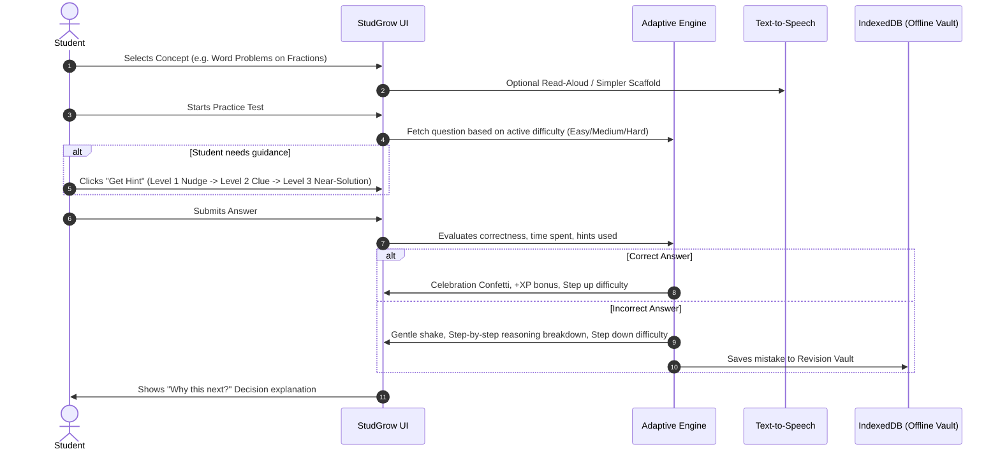

# 🚀 StudGrow — Adaptive Learning Platform for Classes 6 to 10

[](https://vitejs.dev/)
[](https://react.dev/)
[](https://www.typescriptlang.org/)
[](https://tailwindcss.com/)
[](https://threejs.org/)
[](https://web.dev/progressive-web-apps/)

> **StudGrow** is an intelligent, full-viewport adaptive learning SaaS platform engineered specifically for students in Classes 6 through 10. By adjusting question difficulty, learning pace, and conceptual scaffolding in real time, StudGrow ensures every learner builds strong foundational and advanced mastery.

---

## 🌟 The Core Purpose

Students learn at varying speeds: some grasp a concept immediately, others catch partial threads, and some struggle with abstract representations. StudGrow bridges this gap by continuously adapting:
1. **Difficulty**: Seamlessly modulates between Easy, Medium, and Hard based on student answer streaks.
2. **Pace**: Slows down with step-by-step guidance when a student stumbles; unlocks rapid "Challenge Mode" for high-velocity mastery.
3. **Content Scaffolding**: Offers 4 different presentation styles (Basic, Detailed, Visual, and Real-Life Example) plus an instant **"Explain Simpler"** scaffold and Web Speech Text-to-Speech (TTS).
4. **Explainability ("Why this next?")**: Every transition, difficulty shift, or prerequisite recommendation is explicitly explained to both the student and the educator.

---

## 🏛️ System Architecture



---

## 🔄 Student Adaptive Learning Cycle



---

## ✨ Features Checklist

### 🎓 1. Student Portal
- **Dashboard**: Greeting with interactive 3D Mascot Orb, streak counter, XP & level, "Continue where you left off" card, Subject 3D-tilt cards with progress rings, and urgent exam alert banners (< 3 days).
- **Curriculum & Subjects**: Comprehensive Class 6–10 subject directory with chapter completion tracking, time estimates, and difficulty indicators.
- **Concept Deep-Dive**: 
  - Tabs: Basic, Detailed, Visual Diagram, Real-World Example.
  - One-click **"Explain Simpler"** button for students needing additional scaffolding.
  - Native Web Speech API read-aloud support.
- **Adaptive Practice Engine**:
  - One question at a time with progress bar, session timer, and streak counter.
  - Multiple formats: MCQ, True/False, and Fill-in-the-blank.
  - 3-tier progressive hint system (Nudge, Clue, Near-Solution).
  - Clear step-by-step reasoning on mistakes with "Try a similar question" button.
- **Rankings & Leaderboard**: Class 8A friendly leaderboard (top 10 with student highlighted). Clicking any roll number opens their complete profile drawer.
- **Targeted Revision Vault**: Automatically captures questions answered incorrectly for reinforcement.
- **Doubt Clearance**: Post doubts with concept tagging and view teacher replies in real time.
- **Offline Study Library**: Searchable e-books, video lectures, formula sheets, and past question papers cached into IndexedDB.

### 👩‍🏫 2. Teacher Portal
- **Class Roster & Analytics**: Overview of 42 students across Class 8A/8B/9A/10B with attendance %, average marks, and quick student profile drawer inspections.
- **Concept Competency Heatmap**: Matrix of Students × Concepts with red/amber/green color coding.
- **Teacher Overrides**: Lock concepts, skip concepts for advanced students, or manually force question difficulty.
- **Assignment Builder**: Push custom practice assignments with deadlines and target difficulties to the class.
- **Doubts Inbox**: Dedicated interface for educators to review and answer student doubts.
- **Exam Management & Grade Entry**: Schedule exams (which dispatches urgent countdowns to student dashboards) and enter monthly assessment marks.
- **Curriculum Quality Review**: QA screen to review, edit, and approve questions before they go live.

### 🎨 3. Visual System & Accessibility
- **Full Viewport Shell**: Optimized for 100vw × 100vh laptop screens with zero body scroll or wasted space.
- **Light & Dark Theme**: Soft off-white mesh (#F7F8FF) and deep navy (#0B1020) with smooth 300ms transitions.
- **3D Graphics**: Interactive Three.js scene on login and animated Mascot Orb on dashboard.
- **Lite Mode**: One-click toggle that switches off WebGL 3D for low-battery or legacy laptops.
- **Dyslexia-Friendly Mode**: Specialized letter-spacing, word-spacing, and high-legibility font rendering.
- **Trilingual Support**: English, Telugu (తెలుగు), and Hindi (हिन्दी) UI localization.

### 📶 4. Offline First & PWA
- Service Worker caching (`sw.js`) and PWA Web Manifest (`manifest.json`).
- IndexedDB via `idb` storing concepts and answers offline.
- Real-time `SyncIndicator` (Online / Offline / Syncing / Synced / Retry) with manual offline simulation toggle.

---

## 🎬 3–5 Minute Seeded Hackathon Demo Script

Follow this path to showcase all capabilities seamlessly in a video or live demo:

1. **Split 3D Login**:
   - Open `/login`. Notice the interactive 3D scene that rotates with mouse movement.
   - Click the **"Autofill Demo"** button (fills Roll `08` and PIN `1405` for Aarav Sharma, DOB: 14/05/2012).
   - Alternatively, test **"Scan QR"** → Click **"Instant Hackathon Demo QR Scan"** or switch to **Avatar Login**.
   - Click **"Log In to StudGrow"**. Watch the welcome animation.

2. **Student Dashboard & Explainability**:
   - Notice the greeting, 14-day streak, Level 6, and Class Rank #5.
   - Point out the **Urgent Exam Alert** banner (Mathematics Mid-Term in 2 days!).
   - Click the **"Why this next?"** pill in the hero to display the algorithm's active reasoning.
   - Click on Roll `#01` (Ananya Reddy) in the Class Standings list to open her full profile drawer with attendance heatmap and report card!

3. **Concept Explanation & Scaffolding**:
   - In "Continue Where You Left Off", click **"Resume Lesson"** (`/concept/c-frac-3`).
   - Switch between **Basic**, **Detailed**, **Visual**, and **Example** tabs.
   - Click **"Explain Simpler"** to view the adaptive scaffolding.
   - Click **"Read Aloud (TTS)"** to hear the audio narration.
   - Click **"START PRACTICE TEST"**.

4. **Adaptive Practice Test & Decision Logging**:
   - Answer the first question incorrectly to showcase the gentle shake, common mistake alert, and step-by-step reasoning.
   - Click **"Try a Similar Question"**.
   - Click **"Get Hint 1 (Nudge)"** to reveal hint level 1.
   - Select the correct answer and click **"Check Answer"**. Enjoy the confetti celebration!
   - Click **"Why this next step?"** to show how the system stepped up the difficulty.
   - Complete the session to see the **Practice Results** screen with animated mastery gains.

5. **Teacher Portal**:
   - Click **"Teacher Portal →"** in the sidebar.
   - Explore the **Concept Heatmap** (Student × Concept grid). Click any cell to test the **Teacher Adaptive Override Modal** (Lock/Skip/Force Difficulty).
   - Navigate to **"Doubts Inbox"** and type an answer to Aarav's question.
   - Navigate to **"Exams & Grade Entry"** to show instant class rank recalibration.

---

## 🛠️ Installation & Local Setup

### Prerequisites
- Node.js (version 18+ or 20+ recommended)
- npm or yarn

### 1. Clone & Install Dependencies
```bash
git clone https://github.com/your-username/studgrow.git
cd studgrow
npm install
```

### 2. Run Development Server
```bash
npm run dev
```
Open `http://localhost:5173` in your browser.

### 3. Production Build
```bash
npm run build
npm run preview
```

---

## 🚀 Deployment

### Deploy to Vercel
The repository includes a ready `vercel.json` rewrite configuration:
```bash
npm install -g vercel
vercel
```

### Deploy to Netlify
The repository includes a ready `public/_redirects` SPA fallback file:
```bash
npm run build
# Publish the dist/ folder to Netlify
```

---

## 👨‍💻 Tech Stack Summary
- **Frontend Framework**: React 18 + Vite + TypeScript
- **Styling & Design System**: Tailwind CSS with Glassmorphic backdrop filters
- **State Management**: Zustand
- **3D Graphics**: Three.js, `@react-three/fiber`, `@react-three/drei`
- **Charts**: Recharts
- **Offline Storage**: IndexedDB via `idb`
- **Icons & Celebrations**: Lucide React & `canvas-confetti`
- **Text-to-Speech**: Web Speech API

---

*StudGrow — Making every student strong through explainable, accessible, and adaptive learning.*
